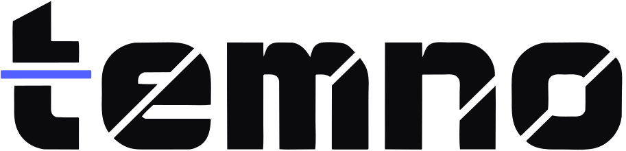

<div align="center">

<a href="https://temno.io"><picture><source media="(prefers-color-scheme: dark)" srcset="assets/wordmark-white.svg" /><source media="(prefers-color-scheme: light)" srcset="assets/wordmark-ink.svg" /></picture></a>

**The next cut is yours.**

<a href="https://github.com/temno-io/temno/releases"><picture><source media="(prefers-color-scheme: dark)" srcset="assets/download-dark-theme.svg" /><source media="(prefers-color-scheme: light)" srcset="assets/download-light-theme.svg" /></picture></a>

<sub><i>Requires Windows 11, 64-bit</i></sub>

</div>


---

Temno is a native Windows video editor you can edit by hand or hand to an agent. Agents work on the same timeline you do, through the same edit commands, and every change they make undoes with Ctrl+Z.

### Native Windows editor

Temno is built on WinUI 3, .NET 10, Direct3D 11 and FFmpeg 9.1. There is no Electron shell. The timeline, keyframes, color, captions, English transcription and export to H.264, HEVC and ProRes all run on your PC, with no account.

### Hand it to an agent

Connect Claude Code, Cursor, Codex or another coding agent over MCP. Over MCP an agent has 77 tools. It can look at preview frames, read transcripts, cut on the beat, remove silences, grade, caption and export.

The chat panel inside the app does the same work, on Temno's hosted models or your own Anthropic API key.

### Built-in generation

Generate video, images, music and voice inside the editor. Temno shows the exact credit cost before a job starts.

## MCP server

While Temno is open it runs an MCP server at `http://127.0.0.1:19789/mcp`. Every request needs a token. **Settings → MCP** shows your token and a ready-made configuration for Claude Code, Cursor, Codex, Claude Desktop, Grok CLI and Gemini CLI.

**Claude Code**

```powershell
claude mcp add --transport http temno http://127.0.0.1:19789/mcp --header "X-Temno-Mcp-Token: <token>"
```

**Cursor** (`~/.cursor/mcp.json`)

```json
{
  "mcpServers": {
    "temno": {
      "type": "http",
      "url": "http://127.0.0.1:19789/mcp",
      "headers": {
        "X-Temno-Mcp-Token": "<token>"
      }
    }
  }
}
```

**Codex** (`~/.codex/config.toml`)

```toml
[mcp_servers.temno]
url = "http://127.0.0.1:19789/mcp"
http_headers = { "X-Temno-Mcp-Token" = "<token>" }
```

The server answers only on this PC, so don't tunnel or expose the port. The token is not an AI provider key, as external agents bring their own model.

## Build from source

You need Windows 11 on x64, Git, PowerShell 7 and the [.NET 10 SDK](https://dotnet.microsoft.com/download/dotnet/10.0), 10.0.400 or later (`winget install Microsoft.DotNet.SDK.10`). Visual Studio is not required.

```powershell
git clone https://github.com/temno-io/temno.git
cd temno
.\scripts\run-app.ps1 -Configuration Release
```

The build restores FFmpeg 9.1 as the NuGet package [`Temno.FFmpeg.Runtime.win-x64`](https://www.nuget.org/packages/Temno.FFmpeg.Runtime.win-x64), and `run-app.ps1` fetches the English Whisper model from a pinned revision and checks its size and hash. `.\scripts\ci-build.ps1` does what CI does: a Release build, the Core tests and an unsigned MSIX. `.\scripts\build-zip.ps1` builds the Temno-win-x64.zip a release carries.

A copy you build is the same app. It signs in with your Google account and uses the same credits and plans, and About says "Built from source" with its commit. It never installs Temno's package over itself: when a release is out it names the tag, and you merge that tag and rebuild so your own changes stay.

Accounts and billing are supported for everyone. App bugs are supported on official builds.

To run against a backend of your own, build with `-p:TemnoEnvironment=development`. That copy runs as Temno-Dev beside Temno, on MCP port `19790`, and keeps hosted features off until you point it at your backend.

Temno's FFmpeg is built from FFmpeg's release tarball by the recipe in [`scripts/ffmpeg/`](scripts/ffmpeg/), which pins every file by SHA-256. With Docker installed, `pwsh scripts/ffmpeg/build-ffmpeg.ps1` rebuilds it and fails unless every file matches.

## FAQ

**How do I install Temno?**

Download Temno-win-x64.zip from the [release](https://github.com/temno-io/temno/releases), extract it and open Temno.App.exe in the extracted folder. Windows asks before it runs a build that is not signed: choose More info, then Run anyway. FFmpeg and the English transcription model come inside the folder.

**Is Temno free?**

Yes. The editor is free and needs no account: editing, export, local English transcription and the local MCP connection all work signed out. Hosted chat, generation and cloud transcription use credits. Sign in with Google and an eligible new account gets 250 free credits, once. Plans are on the [pricing page](https://temno.io/pricing/).

**What platforms does it support?**

Windows 11, 64-bit, where Temno has been tested. Windows 10 is untested, and there is no ARM version.

**What leaves my PC?**

Editing, preview, export, local transcription and search stay on your PC, and the app sends no telemetry or crash reports. Hosted chat, generation and cloud transcription send what you submit to Temno's service and the model's provider. Signing in uses Google, and update checks contact Temno. The [Privacy Policy](https://temno.io/privacy) has the details.

**How does Temno update?**

Temno checks for a new release when it starts, then at most once an hour, and tells you when one is out. This build does not replace itself: download the new release and use it instead of the old folder. Your projects and settings stay where they are.

**Is everything open source?**

The editor is, under GPL-3.0. Temno's hosted services, such as accounts, credits and generation, run on Temno's servers and are not in this repository.

## Contributing

Issues are open for bug reports and feature requests. Pull requests are not accepted yet, and [CONTRIBUTING.md](CONTRIBUTING.md) explains why and how to share a fix.

Report a security problem privately to security@temno.io. See [SECURITY.md](SECURITY.md).

## License

Temno is licensed under the [GNU General Public License, version 3](LICENSE).

It is an independent Windows reimplementation and derivative work based on the source of [Palmier Pro](https://github.com/palmier-io/palmier-pro/tree/last-gpl-source) that Palmier, Inc. published under GPL-3.0. Temno is not affiliated with, endorsed by, sponsored by or distributed by Palmier, Inc.

[NOTICE](NOTICE) holds the upstream copyright and attribution, and [THIRD-PARTY-NOTICES.md](THIRD-PARTY-NOTICES.md) lists the bundled components, including the GPL build of FFmpeg. The license covers the code, not the Temno name or logo: see [TRADEMARKS.md](TRADEMARKS.md).
